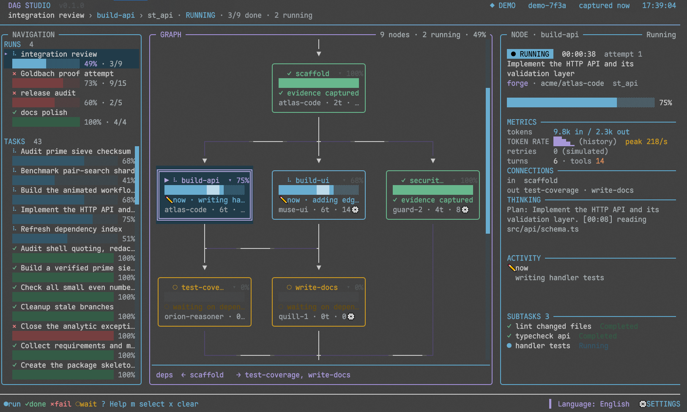

# Herdr DAG Studio

**English** | [中文](README_ZH.md)

An animated, three-pane workflow dashboard for **OmO** workflows inside
**Herdr**. It uses the proven "extension writes a snapshot, viewer reads it"
architecture, then adds a much richer terminal UI:



*Demo mode: a running integration review with the selected node's details.*

- **Navigation** — active, failed, and completed runs with mini progress bars;
  run titles follow the OmO TODO item that was in progress when the run was created.
- **Graph** — topological DAG, animated edge flow, running spinners, pulsing
  borders, per-node progress, folded node mode, and scroll follow.
- **Details** — status, elapsed time, agent/model, tokens in/out, turns, tools,
  retries, live activity, token-rate sparkline, dependencies, subtasks, errors,
  bounded model reasoning and reply excerpts, and verbose recent logs. Selecting
  a run shows a run summary: tokens, cost, cache hit rate, wall/busy time,
  critical path, and parallelism, with an explicit `seen/total` coverage marker
  when node evidence is partial.
- **Animation** — 60 fps while a run, task, or scroll is active in interactive
  terminals (`--fps N` overrides up to 120); the wide three-pane layout never
  drops below 24 fps so ambient animation stays smooth, the duty layout idles
  at 1 fps, the pager suspends frames, and input/state changes repaint
  immediately. `--no-motion` keeps the 1 fps clock tick. Spinner, breathing
  status colors, flowing-light edge trails, progress shimmer, smooth Page
  Up/Down and mouse-wheel scrolling, and a LIVE pulse. State changes appear in
  the footer so they never cover graph or detail content.
- **Demo data** — a deterministic fake workflow that runs without OmO or Herdr,
  so the UI can be inspected in any terminal. It includes a 15-node Goldbach
  proof-attempt campaign with 21 Goldbach-themed tasks and 25 subtasks.
- **Themes** — the five themes OmO lists: `system`, `dark`, `light`,
  `grok-day`, and `grok-night`, with OmO's colors. `system` follows the
  terminal's light/dark appearance and leaves page surfaces and body text at
  the terminal defaults, so the terminal's background (including transparency)
  shows through. Until you pick one in the studio, the viewer follows OmO's own
  `theme` setting; switch with `s` → Theme. The choice is saved to
  `~/.config/nero-herdr-dag/config.json`.
- **Language** — English and Simplified Chinese UI chrome, selected with `s`
  or the `⚙ SETTINGS` button at the far right of the footer. The choice is saved to
  `~/.config/nero-herdr-dag/config.json` and restored on the next launch.

## Quick start

Requires **Bun 1.4+**. The installed viewer prefers Bun and falls back to
Node.js 24+ when Bun is unavailable.

```bash
bun install
bun run demo
```

That launches the built-in demo in the current terminal. To render one plain
frame for inspection or CI:

```bash
bun run demo:once
# equivalently
bun src/viewer.mjs --demo --once --no-color --width 120 --height 40
```

Write the fake snapshot to disk without starting the TUI:

```bash
bun run make-demo
# demo/snapshot.json
```

## Demo scenario

The fake data is generated by `src/demo.mjs` on a repeating 160-second timeline:

| Node | Window | Depends on |
| --- | --- | --- |
| intake | 0–6s | — |
| scaffold | 6–18s | intake |
| build-api | 18–70s | scaffold |
| build-ui | 18–75s | scaffold |
| security-review | 18–40s | scaffold |
| test-coverage | 70–88s | build-api |
| write-docs | 75–98s | build-api, build-ui |
| verify-evidence | 98–118s | test-coverage, security-review, write-docs |
| release | 118–138s | verify-evidence |

The run is completed from 138–160s, then the cycle restarts. Three static runs
(`Goldbach proof attempt`, `docs polish`, `release audit`) add a failed proof
campaign plus completed and failed/error examples. Standalone tasks show
running, completed, pending, paused, and failed statuses. Subtasks are attached
to API, test, docs, and Goldbach tasks.

### Goldbach proof attempt

The demo also includes a synthetic **Goldbach proof attempt** campaign. Its
15-node DAG covers statement formalization, a verified prime sieve, exhaustive
small-case checks, finite pair search through 4e18, Lean formalization and
kernel checking, counterexample hunting, an analytic exceptional-set bound,
an induction step, independent review, evidence packaging, and publication.
It carries 21 Goldbach-themed tasks and 25 subtasks.
The analytic and induction nodes fail with explicit gaps, downstream nodes are
blocked, and the publication claim is cancelled. This is an illustrative proof
campaign, **not** a real proof of Goldbach's conjecture, which remains open.

Use `←/→` or click the run in the sidebar to inspect it. Its linked tasks appear
in node details; the sidebar also has Goldbach-themed standalone tasks such as
`Audit prime sieve checksum`, `Benchmark pair-search shard`, and
`Review Lean induction lemma`.

Start the demo 32 seconds into the cycle for a screen full of parallel work:

```bash
bun src/viewer.mjs --demo             # default start: 32s into the cycle
bun src/viewer.mjs --demo --scenario early
bun src/viewer.mjs --demo --scenario late
```

## Controls

| Key | Action |
| --- | --- |
| `↑/↓`, `j/k` | Scroll the focused region one line |
| `Tab` / `Shift-Tab` | Select next/previous cell |
| Click | Select a node, task, or run |
| `m` | Release mouse tracking for Herdr drag-select/copy; press again to restore viewer mouse controls |
| `x` / `X` | Hide finished runs and tasks (completed or failed) from this view / restore them |
| Mouse wheel | Scroll the focused region: the graph by its viewport height minus 4 rows, other regions by half a viewport |
| `←/→` | Switch run |
| `Space` / `Enter` | Fold/unfold the selected graph node |
| `d` | Toggle verbose details on wide or expanded layouts; duty stays compact |
| `t` | Focus task details; opens the switcher on narrow layouts |
| `1` / `2` / `3` | Focus RUNS / CELLS / the current node panel on narrow layouts |
| `e` / `Esc` | Focus details / return to the graph |
| `f` | Toggle auto-follow |
| `s` | Open settings (theme, animation, language) |
| `S` | Toggle sidebar on wide layouts |
| `g` / `G`, `Home` / `End` | Jump the focused region to top/bottom |
| `PageUp/PageDown` | Scroll the focused region by the same per-region step as the mouse wheel |
| `r` | Restart the demo cycle |
| `?` / `Esc` | Open/close detailed help; the footer `? Help` is clickable. Help scrolls with `↑/↓`, `PgUp/PageDown`, `g/G`, and `Home/End` |
| `q`, `Ctrl+C`, `Ctrl+D` | Quit |

The footer keeps the legend (`●run ✓done ×fail ◌wait`), followed by the
clickable `? Help`, `m select`, and `x clear` hints, with `⚙ Settings` at the far
right. At 54-69 columns the legend collapses to `● ✓ × ◌` and both action
names stay visible; below 54 columns the footer keeps only the keys. While Help
is open it owns the keyboard: background actions are
blocked and `?`, `Esc`, or a left click closes it. Settings are grouped in one
popup: Theme, Animation, and Language. Theme and Language persist; Animation is
labeled `this session` until it is persisted. Hiding finished items (completed
or failed) is view-only; `X` restores them and no snapshot or record file is
deleted. In Herdr, `m` is the path to native text
selection; with the default `copy_on_select = true`, releasing the drag copies
the selection.

## Inspecting your own snapshot

The viewer accepts the current v3 snapshot plus the v2 and original v1 snapshots
from `omo-herdr-dag`:

```bash
bun src/viewer.mjs --state /path/to/snapshot.json
# High-refresh terminal: opt in to 120 fps (default 60)
bun src/viewer.mjs --state /path/to/snapshot.json --fps 120
```

The file is watched and the dashboard refreshes when the producer replaces it.
Use `--once` for a single frame. `--no-color` and `--no-motion` are available
for accessibility and deterministic output.

## Install as an OmO extension

Install directly from the source checkout with the Makefile:

```bash
make install
make update
make uninstall
```

`make install` runs `bun install`, builds `dist/`, and installs a new extension
generation. `make update` reinstalls the current checkout; it does not pull from
Git. `make uninstall` removes the managed wrapper and integration directory but
preserves user config and state.

The equivalent explicit commands are:

```bash
bun install
bun run build
bun scripts/install.mjs --dry-run
bun scripts/install.mjs
```

Or use the CLI:

```bash
bun bin/dag-studio.mjs install --agent-dir /path/to/agent
bun bin/dag-studio.mjs uninstall --agent-dir /path/to/agent
```

The install lifecycle targets (`make install`, `make update`, `make uninstall`)
accept `AGENT_DIR=/path/to/agent` for a non-default agent directory. `make test`,
`make build`, and `make check` run the Bun test/build workflow.

The installer selects the agent directory in this order:

1. `--agent-dir PATH`
2. `OMO_CODING_AGENT_DIR`
3. `SENPI_CODING_AGENT_DIR`
4. `~/.omo/agent`

It creates a new generation under `<agent-dir>/herdr-dag-studio/integration/`
and a stable wrapper at `<agent-dir>/extensions/omo-herdr-dag-studio.js`.
Each install gets a fresh module URL, so `/reload` actually loads changed
transitive modules. Previous generations remain as backups.

After installing, start a new OmO session in a Herdr pane or run `/reload` in
an existing one. Then use:

```text
/dag-studio
```

The extension only activates when all of these are true:

- `HERDR_ENV=1`
- `HERDR_PANE_ID` and `HERDR_SOCKET_PATH` are set
- the socket path exists
- a real `herdr` binary is found via `HERDR_BIN_PATH` or `PATH`

The viewer is opened with `herdr pane split --ratio 0.667 --no-focus` and the
`--pane` flag. Herdr's ratio is the source pane's share, so the source keeps
two-thirds and the embedded viewer takes one-third of the width. While narrow it
stacks RUNS, CELLS, and the current node/details panel, with a focus glyph on
the active pane; there is no graph at this width. Widening or zooming the pane
to full screen restores the navigation column and the graph. A live viewer is reused; a manually closed
viewer stays closed until `/dag-studio` is run.

## Configuration

| Variable | Default | Purpose |
| --- | --- | --- |
| `OMO_HERDR_DAG_STUDIO_STATE_DIR` | `~/.omo/agent/herdr-dag-studio` | Snapshot, pane record, and view-preference directory |
| `OMO_HERDR_DAG_STUDIO_TASK_STATE_DIR` | `~/.omo/agent/projects/<project-key>/senpi-task` | OmO agent task store root (`tasks/`, `dag/runs/`); repository-local stores are never read |
| `OMO_HERDR_DAG_STUDIO_RUNTIME` | probed Bun 1.4+ / Node 24+ | Explicit viewer runtime; legacy `OMO_HERDR_DAG_STUDIO_NODE` is also accepted |
| `OMO_HERDR_DAG_STUDIO_RETENTION_DAYS` | `14` | Snapshot retention; `0` or invalid disables pruning |
| `OMO_HERDR_DAG_STUDIO_STALE_MS` | `60000` | Capture age in ms before a connected snapshot is marked `▲ STALE`; invalid or non-positive values use the default |
| `NERO_HERDR_DAG_CONFIG_DIR` | `~/.config/nero-herdr-dag` | Override the UI config directory (the language is stored in `config.json`) |

A connected capture older than `OMO_HERDR_DAG_STUDIO_STALE_MS` renders
`▲ STALE` in the header and the source section, and its elapsed clock stops at
the capture time instead of growing. Below 48 columns the header keeps the age
as a compact unit (`8h`). An unreadable source store stays visible under
`SOURCE` with its counts, root, scan age, and error; retry counts name
their provenance (`derived from turns`, `recorded from failed turns`, or
`not recorded`); token rates distinguish `(instant)`, `(average (lifetime))`,
`(constant)`, `(tick-sampled)`, and `(history)`.

The language can also be changed with `s`, or from the `⚙ SETTINGS` button at the
far right of the footer.
Workflow-provided labels, task descriptions, and logs are displayed as-is;
only the interface chrome is translated.

## Architecture

```text
OmO process                                  Herdr viewer process
┌──────────────────────────────┐             ┌───────────────────────────────┐
│ extension.mjs                │  snapshot   │ viewer.mjs                    │
│  ├─ omo.dag.updated          │ ──────────> │  ├─ fs.watch + 60 fps loop    │
│  ├─ omo.task.updated         │   JSON      │  ├─ model / graph layout      │
│  ├─ task store watcher       │             │  ├─ canvas + theme + panels   │
│  ├─ DAG checkpoint restore   │             │  ├─ keys, follow, folds       │
│  └─ stream tap (child agents)│             │  └─ .view.json sidecar        │
│            │                 │             └───────────────────────────────┘
│            └─ herdr pane split/rename/run/close
└──────────────────────────────┘
```

- `src/text.mjs` measures grapheme-aware width and fits, pads, and wraps text.
- `src/theme.mjs` maps OmO palettes onto the dashboard and emits truecolor or
  256-color output with color interpolation.
- `src/canvas.mjs` paints a cell canvas with borders, clipping, and ANSI output.
- `src/model.mjs` normalizes v1, v2, and v3 snapshots, derives mode and field
  provenance, sanitizes text, and computes topological layers.
- `src/demo.mjs` produces the deterministic fake world.
- `src/graph.mjs` lays out wrapped frontiers and animated Manhattan edges.
- `src/render.mjs` composes the header, navigation, duty and investigation
  layouts, graph, details, footer, toasts, settings menu, and help overlay.
- `src/i18n.mjs` contains the English/Chinese message tables and interpolation.
- `src/config.mjs` loads and atomically saves the language and theme, and
  resolves the stale threshold from `OMO_HERDR_DAG_STUDIO_STALE_MS`.
- `src/view-state.mjs` persists fold and sidebar preferences, owns the
  112-column layout breakpoint, and models run and task switcher selection.
- `src/scroll.mjs` maps keys to scroll intents, hit-tests regions, sizes
  scrollbars, and applies exponential easing.
- `src/mouse.mjs` parses SGR and X10 mouse reports.
- `src/clipboard.mjs` builds failure diagnosis cards, guards record paths, and
  copies evidence through OSC52 or a pager.
- `src/omo.mjs` resolves the OmO agent directory, project key, theme, and
  light/dark appearance.
- `src/controller.mjs` serializes events into snapshots and manages the Herdr
  pane.
- `src/task-data.mjs` reads and merges task stores and parent/child records.
- `src/stream-tap.mjs` captures live activity from child agents.
- `src/todo-title.mjs` matches run titles to OmO TODO events.
- `src/herdr.mjs` resolves the herdr binary and wraps its pane commands.
- `src/runtime.mjs` probes for Bun 1.4+ or Node 24+.
- `src/storage.mjs` reads and atomically writes JSON.
- `src/retention.mjs` prunes only owned snapshot files past the retention
  window.
- `src/viewer.mjs` runs the watch loop, input handling, follow, smooth scroll,
  mouse selection, and pager.

### v3 snapshot

```json
{
  "version": 3,
  "sessionId": "demo-7f3a",
  "mode": "live",
  "connected": true,
  "updatedAt": "2026-11-09T09:00:00.000Z",
  "provenance": {
    "origin": "controller",
    "statePath": "/home/me/.omo/agent/herdr-dag-studio/0123456789abcdef01234567.json",
    "taskStateDir": "/home/me/.omo/agent/projects/my-repo-d1641f7e/senpi-task",
    "capturedAt": "2026-11-09T09:00:00.000Z",
    "view": "watch"
  },
  "sources": [{
    "id": "agent-project-1234abcd", "label": "host store", "origin": "agent-project",
    "root": "/home/me/.omo/agent/projects/my-repo-d1641f7e/senpi-task", "status": "ok",
    "tasks": { "files": 12, "accepted": 12, "foreign": 0, "invalid": 0 },
    "runs": { "files": 4, "accepted": 4, "foreign": 0, "invalid": 0 },
    "scannedAt": "2026-11-09T09:00:00.000Z"
  }],
  "runs": [{ "id": "run", "name": "integration review", "status": "running",
    "nodes": [{ "id": "api", "label": "build-api", "state": "running", "taskId": "st_api" }],
    "edges": [{ "from": "api", "to": "tests" }] }],
  "tasks": [{ "id": "st_api", "description": "Build the API", "status": "running",
    "percent": 72, "tokensIn": 12400, "tokensOut": 3100, "turns": 8, "toolCalls": 21,
    "activity": { "phase": "text", "text": "editing routes", "since": 0, "lastAt": 0 } }]
}
```

`mode` is `live` for a connected controller feed, `saved` for a disconnected
capture, and `demo` for the built-in demo data. `provenance` records the
snapshot's origin (`controller`, `demo-engine`, `legacy-snapshot`, or
`viewer-placeholder`), the state path, the task store root, the capture time,
and whether the viewer is watching or rendering once. `sources` lists every
task and checkpoint store the controller scanned, with per-store counts, scan
time, and an error when a store is unreadable. The viewer derives per-field
provenance (`recorded`, `derived`, `simulated`, `unavailable`, or `unknown`)
from the records behind each value.

Only an explicit field whitelist is persisted for tasks. Prompts, full output,
full final responses, and transcripts are never copied into snapshots. The
detail panel includes only bounded, sanitized reasoning and reply excerpts.

## Development

```bash
bun test            # 319 behavior tests
bun run build       # syntax-check and assemble dist/
bun run check       # test + build
```

The tests cover snapshot normalization, topological layers, the demo timeline,
responsive rendering at 120/90/70 columns, ANSI/no-color output, view-state
persistence, English/Chinese message parity, language config persistence, the
settings menu, connector corner/obstacle routing, shared connector corridors,
smooth scroll easing, the complex Goldbach demo campaign, and controller pane
reuse/failure behavior.

## Limitations

- The extension consumes OmO/Senpi internal event and task-store contracts.
  Future OmO versions may change those contracts.
- The viewer prefers Bun 1.4+ and falls back to Node.js 24+. A compiled
  OmO/Bun executable is not used as a general JavaScript interpreter.
- The demo is intentionally synthetic; it does not execute agents or workflows.

## License

MIT.
