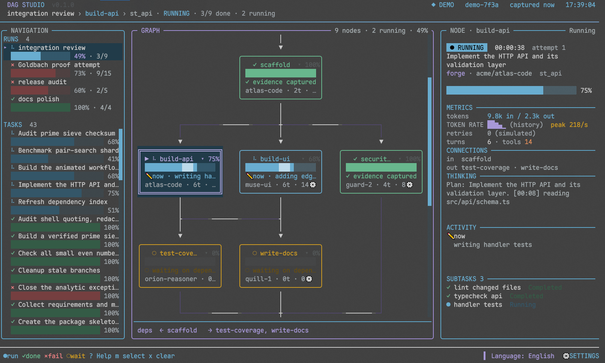

# Herdr DAG Studio

**English** | [中文](README_ZH.md)

An animated, three-pane workflow dashboard for **OmO** workflows inside
**Herdr**. It uses the proven "extension writes a snapshot, viewer reads it"
architecture, then adds a much richer terminal UI:



*Demo mode: a running integration review with the selected node's details.*

- **Navigation** — active, failed, and completed runs with mini progress bars;
  run titles follow the OmO TODO item that was in progress when the run was created.
- **Graph** — topological DAG, animated edge flow, running spinners, pulsing
  borders, per-node progress, folded node mode, and scroll follow.
- **Details** — status, elapsed time, agent/model, tokens in/out, turns, tools,
  retries, live activity, token-rate sparkline, dependencies, subtasks, errors,
  bounded model reasoning and reply excerpts, and verbose recent logs. Selecting
  a run shows a run summary: tokens, cost, cache hit rate, wall/busy time,
  critical path, and parallelism, with an explicit `seen/total` coverage marker
  when node evidence is partial. Spawned and plan tasks add a task contract:
  host summary, owner, execution mode, model chain, run stats, and the
  extracted plan path/role.
- **Animation** — 60 fps while a run, task, or scroll is active in interactive
  terminals (`--fps N` overrides up to 120); the wide three-pane layout never
  drops below 24 fps so ambient animation stays smooth, the duty layout idles
  at 1 fps, the pager suspends frames, and input/state changes repaint
  immediately. `--no-motion` keeps the 1 fps clock tick. Spinner, breathing
  status colors, flowing-light edge trails, progress shimmer, smooth Page
  Up/Down and mouse-wheel scrolling, and a LIVE pulse. State changes appear in
  the footer so they never cover graph or detail content.
- **Demo data** — a deterministic fake workflow that runs without OmO or Herdr,
  so the UI can be inspected in any terminal. It includes a 15-node Goldbach
  proof-attempt campaign with 21 Goldbach-themed tasks and 25 subtasks.
- **Themes** — the five themes OmO lists: `system`, `dark`, `light`,
  `grok-day`, and `grok-night`, with OmO's colors. `system` follows the
  terminal's light/dark appearance and leaves page surfaces and body text at
  the terminal defaults, so the terminal's background (including transparency)
  shows through. Until you pick one in the studio, the viewer follows OmO's own
  `theme` setting; switch with `s` → Theme. The choice is saved to
  `~/.config/nero-herdr-dag/config.json`.
- **Language** — English and Simplified Chinese UI chrome, selected with `s`
  or the `⚙ SETTINGS` button at the far right of the footer. The choice is saved to
  `~/.config/nero-herdr-dag/config.json` and restored on the next launch.

## Quick start

Requires **Bun 1.4+**. The installed viewer prefers Bun and falls back to
Node.js 24+ when Bun is unavailable.

```bash
bun install
bun run demo
```

That launches the built-in demo in the current terminal. To render one plain
frame for inspection or CI:

```bash
bun run demo:once
# equivalently
bun src/viewer.mjs --demo --once --no-color --width 120 --height 40
```

Write the fake snapshot to disk without starting the TUI:

```bash
bun run make-demo
# demo/snapshot.json
```

## Demo scenario

The fake data is generated by `src/demo.mjs` on a repeating 160-second timeline:

| Node | Window | Depends on |
| --- | --- | --- |
| intake | 0–6s | — |
| scaffold | 6–18s | intake |
| build-api | 18–70s | scaffold |
| build-ui | 18–75s | scaffold |
| security-review | 18–40s | scaffold |
| test-coverage | 70–88s | build-api |
| write-docs | 75–98s | build-api, build-ui |
| verify-evidence | 98–118s | test-coverage, security-review, write-docs |
| release | 118–138s | verify-evidence |

The run is completed from 138–160s, then the cycle restarts. Three static runs
(`Goldbach proof attempt`, `docs polish`, `release audit`) add a failed proof
campaign plus completed and failed/error examples. Standalone tasks show
running, completed, pending, paused, and failed statuses. Subtasks are attached
to API, test, docs, and Goldbach tasks.

### Goldbach proof attempt

The demo also includes a synthetic **Goldbach proof attempt** campaign. Its
15-node DAG covers statement formalization, a verified prime sieve, exhaustive
small-case checks, finite pair search through 4e18, Lean formalization and
kernel checking, counterexample hunting, an analytic exceptional-set bound,
an induction step, independent review, evidence packaging, and publication.
It carries 21 Goldbach-themed tasks and 25 subtasks.
The analytic and induction nodes fail with explicit gaps, downstream nodes are
blocked, and the publication claim is cancelled. This is an illustrative proof
campaign, **not** a real proof of Goldbach's conjecture, which remains open.

Use `←/→` or click the run in the sidebar to inspect it. Its linked tasks appear
in node details; the sidebar also has Goldbach-themed standalone tasks such as
`Audit prime sieve checksum`, `Benchmark pair-search shard`, and
`Review Lean induction lemma`.

Start the demo 32 seconds into the cycle for a screen full of parallel work:

```bash
bun src/viewer.mjs --demo             # default start: 32s into the cycle
bun src/viewer.mjs --demo --scenario early
bun src/viewer.mjs --demo --scenario late
```

## Controls

| Key | Action |
| --- | --- |
| `↑/↓`, `j/k` | Scroll the focused region one line |
| `PageUp` / `PageDown` (`PgUp` / `PgDn`) | Scroll the focused region one page: the graph moves by its viewport height minus 4 rows, other regions by half a viewport. In Help, one page |
| `g` / `G`, `Home` / `End` | Jump the focused region to top/bottom |
| `Tab` / `Shift-Tab` | Select the next/previous graph node or task |
| Click | Select a node, task, or run |
| `m` | Toggle mouse capture. Released, Herdr handles drag-select and copy; press again to restore viewer mouse controls |
| Mouse wheel | Scroll the region under the pointer (graph: viewport height minus 4 rows; other regions: half a viewport). While the finder is open it moves the selection, and while Help is open it pages Help |
| `←` / `→` | Switch run |
| `Space` / `Enter` | Fold or unfold the selected graph node. While details are focused, `Enter` collapses or expands the current section; in the tour, Space or Enter advances the step |
| `d` | Toggle verbose details on wide or expanded layouts; duty layouts show a toast instead |
| `e` / `Esc` | `e` expands details. `Esc` clears a graph filter/focus, or collapses the expanded details when neither is active |
| `v` or `/` | Open the finder for runs, nodes, and tasks. Type to filter, `↑/↓` or `j/k` to move, `PageUp/PageDown` and `Home/End` to jump, `Backspace` to delete, `Ctrl-U` to clear, Enter to select, and `Esc` or `v` to close |
| `:` | Open the command palette. Type to filter, Enter runs the command, `Esc` or `:` closes it. The palette includes Start tour and Open run summary |
| `f` | Toggle auto-follow |
| `s` | Open settings (theme, animation, language). `↑/↓` or Tab moves, Enter changes, `Esc` closes |
| `S` | Toggle the sidebar on wide layouts (112 columns or more); narrower terminals show a toast |
| `t` | Toggle task scope between run and all on the investigation layout with the sidebar visible; other layouts open the finder |
| `T` | Collapse or expand completed tasks in the task list |
| `1-5` | With a run summary open, filter the graph to all, failed, blocked, running, or critical path |
| `1` / `2` / `3` | In the narrow duty layout, focus RUNS, CELLS, or the current node panel |
| `z` | Focus the selected node and its direct neighbors; press again to clear the focus |
| `n` / `N` | Select the next/previous node in graph order while the graph or cells pane has focus |
| `[` / `]` | Previous/next details section while details are focused. `Enter` collapses or expands the current section |
| `x` / `X` / `u` | `x` hides finished runs and root tasks outside the five-minute recent window from this view; `X` restores every hidden item; `u` undoes the last hide |
| `c` / `p` / `o` | Copy the diagnosis bundle, copy artifact paths, or open the record in the pager. The current selection needs a diagnosis or record |
| `Backspace` | Return from details to the run summary; in the finder or palette it deletes one character |
| `r` | Restart the demo cycle (demo mode only) |
| `?` / `Esc` | Open or close Help. Help takes the keyboard and scrolls with `↑/↓`, `PageUp/PageDown`, `g/G`, and `Home/End` |
| `q`, `Ctrl+C`, `Ctrl+D` | Quit. Close Help first |

The footer keeps the legend (`●run ✓done ×fail ◌wait`), followed by the
clickable `? Help`, `m select`, and `x clear` hints, with `⚙ Settings` at the far
right. At 54-69 columns the legend collapses to `● ✓ × ◌` and both action
names stay visible; below 54 columns the footer keeps only the keys. While Help
is open it owns the keyboard: background actions are
blocked and `?`, `Esc`, or a left click closes it. Settings are grouped in one
popup: Theme, Animation, and Language. Theme and Language persist in
`config.json`; Animation is session-only and the popup labels it `this session`.
Hiding finished items is view-only; `X` restores every hidden item, `u` undoes
the last hide, and no snapshot or record file is deleted. In Herdr, `m` is the path to native text
selection; with the default `copy_on_select = true`, releasing the drag copies
the selection.

## Inspecting your own snapshot

The viewer accepts the current v3 snapshot plus the v2 and original v1 snapshots
from `omo-herdr-dag`:

```bash
bun src/viewer.mjs --state /path/to/snapshot.json
# High-refresh terminal: opt in to 120 fps (default 60)
bun src/viewer.mjs --state /path/to/snapshot.json --fps 120
```

The file is watched and the dashboard refreshes when the producer replaces it.
Use `--once` for a single frame. `--no-color` and `--no-motion` are available
for accessibility and deterministic output.

## Install as an OmO extension

Install directly from the source checkout with the Makefile:

```bash
make install
make update
make uninstall
```

`make install` runs `bun install`, builds `dist/`, and installs a new extension
generation. `make update` reinstalls the current checkout; it does not pull from
Git. `make uninstall` removes the managed wrapper and integration directory but
preserves user config and state.

The equivalent explicit commands are:

```bash
bun install
bun run build
bun scripts/install.mjs --dry-run
bun scripts/install.mjs
```

Or use the CLI:

```bash
bun bin/dag-studio.mjs install --agent-dir /path/to/agent
bun bin/dag-studio.mjs uninstall --agent-dir /path/to/agent
```

The install lifecycle targets (`make install`, `make update`, `make uninstall`)
accept `AGENT_DIR=/path/to/agent` for a non-default agent directory. `make test`,
`make build`, and `make check` run the Bun test/build workflow.

The installer selects the agent directory in this order:

1. `--agent-dir PATH`
2. `OMO_CODING_AGENT_DIR`
3. `SENPI_CODING_AGENT_DIR`
4. `~/.omo/agent`

It creates a new generation under `<agent-dir>/herdr-dag-studio/integration/`
and a stable wrapper at `<agent-dir>/extensions/omo-herdr-dag-studio.js`.
Each install gets a fresh module URL, so `/reload` loads the changed extension
modules. Previous generations remain as backups.

`/reload` does not restart the viewer. The graph pane is a separate Node
subprocess that keeps the generation it was launched with, and `/dag-studio`
reuses a live pane instead of replacing it. After installing, start a new OmO
session (or close the DAG pane and run `/dag-studio` again) to run the new
viewer. If `/dag-studio` reopens a pane whose recorded generation is older than
`current.json`, it warns once and reuses that pane; it never closes the pane for
you. Then use:

```text
/dag-studio
```

The extension only activates when all of these are true:

- `HERDR_ENV=1`
- `HERDR_PANE_ID` and `HERDR_SOCKET_PATH` are set
- the socket path exists
- a real `herdr` binary is found via `HERDR_BIN_PATH` or `PATH`

The viewer is opened with `herdr pane split --ratio 0.667 --no-focus` and the
`--pane` flag. Herdr's ratio is the source pane's share, so the source keeps
two-thirds and the embedded viewer takes one-third of the width. While narrow it
stacks RUNS, CELLS, and the current node/details panel, with a focus glyph on
the active pane; there is no graph at this width. Widening or zooming the pane
to full screen restores the navigation column and the graph. A live viewer is reused; a manually closed
viewer stays closed until `/dag-studio` is run.

## Configuration

| Variable | Default | Purpose |
| --- | --- | --- |
| `OMO_HERDR_DAG_STUDIO_STATE_DIR` | `<agent-dir>/herdr-dag-studio` (`~/.omo/agent/herdr-dag-studio` by default) | Snapshot, pane-record, and view-preference directory. An empty value is kept as written |
| `OMO_HERDR_DAG_STUDIO_TASK_STATE_DIRS` | unset | Task store roots separated by the platform path delimiter (`:` on POSIX, `;` on Windows). When set, it overrides `..._TASK_STATE_DIR` and automatic discovery. Each item is trimmed, `~` is expanded, and a trailing separator is removed |
| `OMO_HERDR_DAG_STUDIO_TASK_STATE_DIR` | unset | One explicit task store root, used only when `..._TASK_STATE_DIRS` is empty. With neither set, the controller discovers the current project's marked `.omo/senpi-task`, the session store, and the host project store `~/.omo/agent/projects/<project-key>/senpi-task` |
| `OMO_HERDR_DAG_STUDIO_RUNTIME` | probed Bun 1.4+ or Node 24+ | Explicit viewer runtime. `OMO_HERDR_DAG_STUDIO_NODE` is a compatibility alias; `RUNTIME` wins |
| `OMO_HERDR_DAG_STUDIO_NODE` | unset | Compatibility alias for `..._RUNTIME` |
| `OMO_HERDR_DAG_STUDIO_OMO_SETTINGS` | `<agent-dir>/settings.json` | OmO settings file read for the initial theme. It wins over the `NERO_` alias |
| `NERO_HERDR_DAG_OMO_SETTINGS` | unset | Compatibility alias for `..._OMO_SETTINGS` |
| `NERO_HERDR_DAG_CONFIG_DIR` | `~/.config/nero-herdr-dag` | UI config directory. `config.json` stores language and theme |
| `OMO_HERDR_DAG_STUDIO_STALE_MS` | `60000` | Capture age in ms before a connected snapshot is marked `▲ STALE`. Empty, non-numeric, or non-positive values use the default |
| `OMO_HERDR_DAG_STUDIO_RETENTION_DAYS` | `14` | Snapshot retention. `0`, negative, or invalid values disable pruning |
| `OMO_CODING_AGENT_DIR` | `~/.omo/agent` | OmO agent directory. It wins over the `SENPI_` alias and anchors the default state and task store paths |
| `SENPI_CODING_AGENT_DIR` | `~/.omo/agent` | Compatibility alias for `OMO_CODING_AGENT_DIR` |
| `HERDR_ENV` | unset | Must be exactly `1` for the extension to activate |
| `HERDR_PANE_ID` | unset | Source Herdr pane id. Required for activation and the pane key |
| `HERDR_SOCKET_PATH` | unset | Herdr socket path. It must exist for activation |
| `HERDR_BIN_PATH` | unset | Explicit `herdr` executable. When unset or not executable, the viewer searches `PATH` |
| `PATH` | process `PATH` | Searched for `herdr` and for the pager executable |
| `PAGER` | `less -R`, then `more` | Pager used by `o` to open a diagnosis record. Only one executable plus flags from a read-only allowlist (less, more, most, pg, lv, bat, batcat, cat) is accepted |

A connected capture older than `OMO_HERDR_DAG_STUDIO_STALE_MS` renders
`▲ STALE` in the header and the source section, and its elapsed clock stops at
the capture time instead of growing. Below 48 columns the header keeps the age
as a compact unit (`8h`). An unreadable source store stays visible under
`SOURCE` with its counts, root, scan age, and error; retry counts name
their provenance (`derived from turns`, `recorded from failed turns`, or
`not recorded`); token rates distinguish `(instant)`, `(average (lifetime))`,
`(constant)`, `(tick-sampled)`, and `(history)`.

The viewer also respects `NO_COLOR` and detects color support from `TERM`,
`COLORTERM`, `COLORFGBG`, and `WT_SESSION`. These are terminal variables, not
studio settings; `--no-color` forces plain output.

The language can also be changed with `s`, or from the `⚙ SETTINGS` button at the
far right of the footer.
Workflow-provided labels, task descriptions, and logs are displayed as-is;
only the interface chrome is translated.

## Architecture

```text
OmO process                                  Herdr viewer process
┌──────────────────────────────┐             ┌───────────────────────────────┐
│ extension.mjs                │  snapshot   │ viewer.mjs                    │
│  ├─ omo.dag.updated          │ ──────────> │  ├─ fs.watch + 60 fps loop    │
│  ├─ omo.task.updated         │   JSON      │  ├─ model / graph layout      │
│  ├─ task store watcher       │             │  ├─ canvas + theme + panels   │
│  ├─ DAG checkpoint restore   │             │  ├─ keys, follow, folds       │
│  └─ stream tap (child agents)│             │  └─ .view.json sidecar        │
│            │                 │             └───────────────────────────────┘
│            └─ herdr pane split/rename/run/close
└──────────────────────────────┘
```

Modules are grouped by role. Every module in `src/` is listed once below.

**Data and normalization**

- `src/model.mjs` normalizes v1, v2, and v3 snapshots, derives mode and field
  provenance, sanitizes text, and computes topological layers, run statistics,
  and selection lookups.
- `src/normalize.mjs` is the one implementation of each host-value primitive:
  text, number, integer, ISO timestamp, byte length, and defined fields.
- `src/evidence.mjs` normalizes host evidence once, covering reasoning and
  reply excerpts, rate history, retries, and turns, for both snapshot and
  task-store readers.
- `src/task-data.mjs` reads and merges task stores and parent/child records.
- `src/run-summary.mjs` aggregates node windows, durations, and totals for the
  run overview without I/O or a hidden clock.
- `src/demo.mjs` produces the deterministic fake world.
- `src/records.mjs` resolves raw task and checkpoint records through bounded,
  root-checked reads.
- `src/viewer-snapshot.mjs` reads state files under a hard byte ceiling, checks
  snapshot limits before mapping, and builds the placeholder and evidence for a
  failed read, plus session identity and change detection.

**Presentation primitives**

- `src/text.mjs` measures grapheme-aware width and fits, pads, and wraps text.
- `src/theme.mjs` maps OmO palettes onto the dashboard and emits truecolor or
  256-color output with color interpolation.
- `src/canvas.mjs` paints a cell canvas with borders, clipping, and ANSI output.
- `src/frame-primitives.mjs` owns reusable cell grids for one frame, plus
  panels, pills, scrollbars, detail rows, and metric formatting.
- `src/graph.mjs` lays out wrapped frontiers and animated Manhattan edges.
- `src/i18n.mjs` contains the English/Chinese message tables and interpolation.

**Frame composition**

- `src/render.mjs` composes the layout, sidebar, graph, and details shell, and
  exports `renderApp`.
- `src/render-chrome.mjs` paints the header brand, breadcrumb and status, plus
  the footer legend, hints, and settings entry.
- `src/render-duty.mjs` paints the wide duty pane and the narrow RUNS/CELLS/DUTY
  surface with its own compact duty body, and reuses the subject label and
  failure-state helpers plus summary and diagnosis sections.
- `src/render-subject.mjs` builds node and task subjects and paints the wide
  details-pane subject body.
- `src/render-summary.mjs` paints metric cards, the run summary, and warnings.
- `src/render-diagnosis.mjs` paints diagnosis cards, the error source, and the
  full reason.
- `src/render-overlays.mjs` paints the command palette, switcher, tour, help,
  and settings overlays, and invalidates their hitboxes.

**Interaction**

- `src/view-model.mjs` is the seam between orchestration and the frame
  renderer. It holds the snapshot, UI state, and last frame, and reconciles
  selection, focus, folds, scrolling, and pointer targets.
- `src/viewer-selection.mjs` holds the selection reducers shared by clicks,
  keys, switcher rows, and follow updates.
- `src/viewer-keymap.mjs` normalizes key spellings and movement, and defines
  the ordered modal and global key tables.
- `src/scroll.mjs` maps keys to scroll intents, sizes scrollbars, and applies
  exponential easing.
- `src/mouse.mjs` parses SGR and X10 mouse reports.
- `src/view-state.mjs` persists fold and sidebar preferences, owns the
  112-column breakpoint, and models run, task, and switcher selection.
- `src/commands.mjs` lists the command palette entries.
- `src/cockpit.mjs` holds the pure failure, blocked, and critical triage rules
  shared by the renderer and the viewer.

**Host and runtime**

- `src/viewer.mjs` runs the watch loop, input dispatch, frame pacing, follow,
  pager, and CLI.
- `src/controller.mjs` serializes events into snapshots and manages the Herdr
  pane.
- `src/omo.mjs` resolves the OmO agent directory, project key, theme, and
  light/dark appearance.
- `src/config.mjs` loads and atomically saves the language and theme, and
  resolves the stale threshold.
- `src/env.mjs` centralizes parsing for the studio's own settings and paths.
  Terminal variables such as `NO_COLOR` and `COLORTERM` stay with the modules
  that read them.
- `src/herdr.mjs` resolves the herdr binary and wraps its pane commands.
- `src/runtime.mjs` probes for Bun 1.4+ or Node 24+.
- `src/storage.mjs` reads and atomically writes JSON.
- `src/retention.mjs` prunes only owned snapshot files past the retention
  window.
- `src/stream-tap.mjs` captures live activity from child agents.
- `src/todo-title.mjs` matches run titles to OmO TODO events.
- `src/diagnosis.mjs` owns the diagnosis model, text, and copyable evidence
  bundle.
- `src/clipboard.mjs` copies evidence through OSC52 or a pager and re-exports
  the diagnosis and path guards for older embedders.
- `src/safe-path.mjs` validates absolute paths and keeps record reads inside a
  trusted root.

Frame composition stays in one owner. It builds the layout, sidebar, graph, and
details shell, then calls the extracted painters. The subject painter turns a
node or task into a subject and draws the wide details-pane body. The duty
painter draws its own compact duty body and reuses the subject label and
failure-state helpers, the summary metric and warning sections, and the compact
diagnosis card, so the two views cannot describe a task differently.

The viewer keeps only orchestration. Snapshot I/O is bounded and validated
before mapping, the view model reconciles selection, focus, folds, and scroll,
and the keymap resolves modal and global keys. The watch loop, frame pacing, and
other side effects stay with the viewer.

### v3 snapshot

```json
{
  "version": 3,
  "sessionId": "demo-7f3a",
  "mode": "live",
  "connected": true,
  "updatedAt": "2026-11-09T09:00:00.000Z",
  "provenance": {
    "origin": "controller",
    "statePath": "/home/me/.omo/agent/herdr-dag-studio/0123456789abcdef01234567.json",
    "taskStateDir": "/home/me/.omo/agent/projects/my-repo-d1641f7e/senpi-task",
    "capturedAt": "2026-11-09T09:00:00.000Z",
    "view": "watch"
  },
  "sources": [{
    "id": "agent-project-1234abcd", "label": "host store", "origin": "agent-project",
    "root": "/home/me/.omo/agent/projects/my-repo-d1641f7e/senpi-task", "status": "ok",
    "tasks": { "files": 12, "accepted": 12, "foreign": 0, "invalid": 0 },
    "runs": { "files": 4, "accepted": 4, "foreign": 0, "invalid": 0 },
    "scannedAt": "2026-11-09T09:00:00.000Z"
  }],
  "runs": [{ "id": "run", "name": "integration review", "status": "running",
    "nodes": [{ "id": "api", "label": "build-api", "state": "running", "taskId": "st_api" }],
    "edges": [{ "from": "api", "to": "tests" }] }],
  "tasks": [{ "id": "st_api", "description": "Build the API", "status": "running",
    "percent": 72, "tokensIn": 12400, "tokensOut": 3100, "turns": 8, "toolCalls": 21,
    "activity": { "phase": "text", "text": "editing routes", "since": 0, "lastAt": 0 } }]
}
```

`mode` is `live` for a connected controller feed, `saved` for a disconnected
capture, and `demo` for the built-in demo data. `provenance` records the
snapshot's origin (`controller`, `demo-engine`, `legacy-snapshot`, or
`viewer-placeholder`), the state path, the task store root, the capture time,
and whether the viewer is watching or rendering once. `sources` lists every
task and checkpoint store the controller scanned, with per-store counts, scan
time, and an error when a store is unreadable. The viewer derives per-field
provenance (`recorded`, `derived`, `simulated`, `unavailable`, or `unknown`)
from the records behind each value.

Only an explicit field whitelist is persisted for tasks. Prompts, full output,
full final responses, and transcripts are never copied into snapshots. The
detail panel includes only bounded, sanitized reasoning and reply excerpts.

## Performance

`bun run bench` runs the committed benchmark against four deterministic
fixtures:

| Fixture | Nodes / edges | Budget |
| --- | --- | --- |
| `demo` | committed demo snapshot | warm frame <= 8 ms |
| `100/185` | 100 / 185 | layout <= 200 ms, warm frame <= 8 ms |
| `300/560` | 300 / 560 | report only, no gate |
| `500/990` | 500 / 990 | report only, no gate |

Those three budgets are release gates: `scripts/bench.mjs` compares the median
and exits non-zero when a row misses. `300/560` and `500/990` publish no budget,
so the harness reports their rows without claiming a pass or fail. At 500/990
the layout cannot be reused, so the `warm` column recomputes the layout inside
the frame. Treat that row as layout-bound and report only.

Timings are medians of a handful of samples, so machine load moves them. Rerun
on an idle machine before calling a miss a regression. The memory probe is a
gate and does not get that excuse.

After the four rows the harness renders 10,000 frames with a fresh snapshot
identity on every frame, forcing the per-snapshot caches to churn. Heap is
sampled after a forced collection every 1,000 frames, and retained growth must
stay within 4 MB. The probe also asserts the caps on the text, theme, subject,
wire-raster, and task-store caches.

### Frame pacing

The demo engine produces a new world every frame, but the viewer accepts a demo
snapshot at most 10 times per second. Animation still runs on the frame clock;
full normalization does not run at 60 Hz.

The viewer starts at 60 fps (`--fps` accepts 2 to 120) and only asks for full
rate while something can change: an active run or task, a scroll in progress,
or demo mode. A stale capture idles, and so does a quiet task list. The narrow
duty layout idles at 1 fps. The wide investigation layout requests up to
24 fps while idle so its ambient animation stays smooth; the pager and
`--no-motion` keep the 1 fps idle tick. Input and state changes repaint
immediately instead of waiting for the idle tick.

The previous frame's render cost also caps the next request: 40 ms or more
drops to 10 fps, 25 ms to 15 fps, 12 ms to 30 fps, otherwise the preferred
rate. No frame is scheduled closer than 8 ms apart.

### Graph caps and badges

The graph is bounded so one oversized snapshot cannot pin the frame loop.

- Layout height is capped at 4,096 rows. Nodes past the cap are not painted,
  and each one is counted as hidden.
- Each edge gets a corridor search of `max(5,000, 1,000,000 / edges)` states.
  An edge that runs out of budget falls back to a deterministic stub wire.
- Neither loss is silent. The graph panel badge names it:

| Badge | Meaning |
| --- | --- |
| `⚠ capped · N hidden` | N nodes were left off the canvas by the layout row cap |
| `⚠ N fallback wires` | N edges use fallback stub routing after the search budget ran out |
| `⚠ N dropped` | N invalid, duplicate, or unknown records were dropped during snapshot normalization |

Badge parts join with ` · `, so one graph can show several at once. The run
summary still reports `seen/total`, so a capped graph never looks like the
whole workflow.

## Development

```bash
bun test            # run the full behavior suite
bun run build       # syntax-check and assemble dist/
bun run check       # test + build
```

The tests cover snapshot normalization, topological layers, the demo timeline,
responsive rendering at 120/90/70 columns, ANSI/no-color output, view-state
persistence, English/Chinese message parity, language config persistence, the
settings menu, connector corner/obstacle routing, shared connector corridors,
smooth scroll easing, the complex Goldbach demo campaign, and controller pane
reuse/failure behavior.

## Limitations

- The extension consumes OmO/Senpi internal event and task-store contracts.
  Future OmO versions may change those contracts.
- The viewer prefers Bun 1.4+ and falls back to Node.js 24+. A compiled
  OmO/Bun executable is not used as a general JavaScript interpreter.
- The demo is intentionally synthetic; it does not execute agents or workflows.

## License

MIT.
