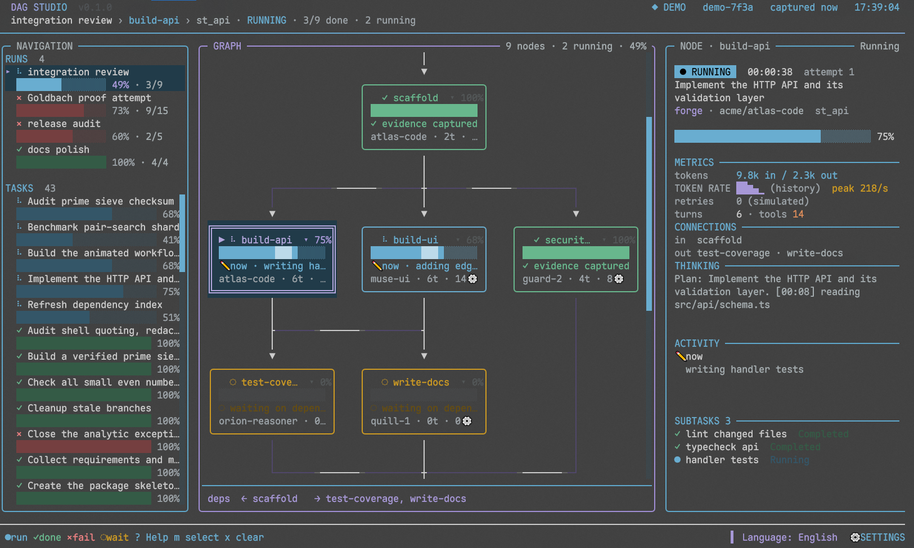

# Herdr DAG Studio

[English](README.md) | **中文**

面向 **OmO** workflow 的动画化三栏终端仪表盘，运行在 **Herdr** 侧栏中。
架构延续“扩展写快照、viewer 读快照”的方式，但重写了展示层。



*演示模式：运行中的 integration review，右侧显示选中节点的详情。*

## 特性

- **导航栏**：活动/失败/已完成 run 列表、迷你进度条、独立任务列表；
  run 标题取自创建 run 时 OmO TODO 中正在进行的条目。
- **DAG 画布**：拓扑分层、自适应换行、边流动点、运行 spinner、
  呼吸边框、进度微光、折叠节点、自动跟随滚动。
- **详情面板**：状态、耗时、agent/model、token 输入输出、轮次、工具调用、
  重试次数、实时活动、token 速率 sparkline、依赖、子任务、错误、模型思考/回复摘录；
  按 `d` 进入详细模式时显示最近日志。选中 run 时显示运行汇总：token、成本、
  缓存命中率、墙钟/忙碌时长、关键路径与并行度；节点证据不完整时标注 `seen/total`。
  被委派或计划任务会显示任务契约：宿主摘要、归属、执行方式、模型链、运行统计，
  以及提取出的计划路径与角色。
- **动画**：有运行中任务、活动滚动或 demo 时按 60 fps 播放（可用 `--fps N` 提升到 120）；宽屏三栏布局至少保持 24 fps，窄屏 duty 布局降到 1 fps，pager 暂停帧循环；输入/状态变化会立即重绘；`--no-motion` 保留 1 fps 时钟刷新。包含平滑 PageUp/PageDown 与鼠标滚轮滚动、LIVE 呼吸点。状态变化提示显示在 footer，不会覆盖画布或详情。
- **与 OmO 一致的主题**：system、dark、light、grok-day、grok-night 五套，使用 OmO 的配色；
  `system` 按终端明暗外观切换，页面背景与正文使用终端默认色，因此终端的背景设置
  （包括半透明效果）会直接透出。未在设置中手动选择前，默认跟随 OmO 的 `theme` 设置。
  按 `s` 打开设置切换，选择保存到 `~/.config/nero-herdr-dag/config.json`。
- **中英文界面**：按 `s` 打开“设置 / SETTINGS”弹窗，或点击 footer 最右侧的 `⚙ 设置`；可选择 English 或中文；
  选择会保存到 `~/.config/nero-herdr-dag/config.json`，下次启动自动恢复。
- **复杂演示用例**：内置 15 节点的“Goldbach 证明尝试”campaign，包含 21 个
  Goldbach 主题任务和 25 个子任务，用于展示大规模失败 workflow。
- **零运行时依赖**：仅使用 Node.js 内置模块。

## 快速开始

需要 **Bun 1.4+**。安装后的 viewer 优先使用 Bun，找不到 Bun 时回退到 Node.js 24+。

```bash
bun install
bun run demo
```

直接在当前终端启动假数据演示。单帧渲染：

```bash
bun run demo:once
bun src/viewer.mjs --demo --once --no-color --width 120 --height 40
```

生成假数据快照：

```bash
bun run make-demo
# demo/snapshot.json
```

## 演示数据

`src/demo.mjs` 在 160 秒周期内生成完整 workflow：

- `intake → scaffold → build-api / build-ui / security-review`
- `build-api → test-coverage / write-docs`
- `test-coverage + security-review + write-docs → verify-evidence → release`
- 另外三个静态 run：`Goldbach proof attempt`（失败）、`docs polish`（全部完成）、
  `release audit`（失败 + 取消）
- 独立任务：运行中、已完成、等待中、暂停中、失败
- API / 测试 / 文档 / Goldbach 任务带子任务

默认从周期第 32 秒开始，因此一启动就能看到多个并行节点。
`--scenario early` 从头开始，`--scenario late` 从周期后段开始。

### Goldbach 证明尝试

演示还包含一个合成的 **Goldbach 证明尝试** campaign，15 个节点覆盖：
命题形式化、素数筛、小范围穷举、到 4e18 的有限区间配对搜索、Lean 形式化与
kernel 检查、反例搜索、解析例外集估计、归纳步骤、独立评审、证据打包与发布。
该 campaign 包含 21 个 Goldbach 主题任务和 25 个子任务。
解析估计和归纳步骤显式失败，下游节点被阻塞，发布声明被取消。

这是一个用于展示复杂 workflow 的合成用例，**不是**对哥德巴赫猜想的真实证明
——该猜想目前仍未解决。启动 demo 后可按 `←/→` 或点击侧栏中的 run 查看；
关联任务显示在节点详情里，侧栏还有 `Audit prime sieve checksum`、
`Benchmark pair-search shard`、`Review Lean induction lemma` 等独立任务。

## 按键

| 按键 | 作用 |
| --- | --- |
| `↑/↓`、`j/k` | 当前聚焦区域向上/向下滚动一行 |
| `PageUp` / `PageDown`（`PgUp` / `PgDn`） | 当前聚焦区域翻一页：图谱按视口高度减 4 行，其他区域翻半个视口。帮助层内翻一页 |
| `g` / `G`、`Home` / `End` | 当前聚焦区域跳到顶部/底部 |
| `Tab` / `Shift-Tab` | 选择下一个/上一个图谱节点或任务 |
| 鼠标点击 | 选中节点、任务或运行 |
| `m` | 开关鼠标捕获。释放后由 Herdr 接管拖选和复制；再按一次恢复 viewer 鼠标操作 |
| 鼠标滚轮 | 滚动指针所在区域（图谱：视口高度减 4 行；其他区域：半个视口）。查找器打开时移动选中项，帮助打开时翻页 |
| `←` / `→` | 切换运行 |
| `Space` / `Enter` | 折叠或展开选中节点。详情聚焦时 `Enter` 折叠或展开当前段落；导览中 Space 或 Enter 进入下一步 |
| `d` | 在宽屏或展开布局切换详细模式；duty 布局只显示提示 |
| `e` / `Esc` | `e` 展开详情。`Esc` 清除图谱过滤/聚焦，两者都没有时收起已展开的详情 |
| `v` 或 `/` | 打开查找（运行/节点/任务）。输入过滤，`↑/↓` 或 `j/k` 移动，`PageUp/PageDown`、`Home/End` 跳转，`Backspace` 删除，`Ctrl-U` 清空，Enter 选中，`Esc` 或 `v` 关闭 |
| `:` | 打开命令面板。输入过滤，Enter 执行命令，`Esc` 或 `:` 关闭。面板包含“开始导览”和“打开运行汇总” |
| `f` | 开关自动跟随 |
| `s` | 打开设置（主题、动画、语言）。`↑/↓` 或 Tab 移动，Enter 修改，`Esc` 关闭 |
| `S` | 宽屏（112 列及以上）开关侧栏；更窄时显示提示 |
| `t` | 宽屏 investigation 布局且侧栏可见时切换任务范围（运行/全部）；其他布局打开查找 |
| `T` | 折叠或展开任务列表中的已完成任务 |
| `1-5` | 打开运行汇总时过滤图谱：全部、失败、阻塞、运行中、关键路径 |
| `1` / `2` / `3` / `4` | 窄屏 duty 布局下聚焦 RUNS、CELLS、当前节点面板，或没有运行关联的孤立任务 TASKS 列表。宽屏布局下 `4` 聚焦侧栏任务列表 |
| `z` | 聚焦选中节点及其直接邻居；再按一次清除聚焦 |
| `n` / `N` | 图谱或 cells 面板聚焦时按图谱顺序选择下一个/上一个节点 |
| `[` / `]` | 详情聚焦时切换到上一个/下一个详情段落。`Enter` 折叠或展开当前段落 |
| `x` / `X` / `u` | `x` 从当前视图隐藏不在五分钟最近窗口内的已结束运行和根任务；`X` 恢复全部隐藏项；`u` 撤销上一次隐藏 |
| `c` / `p` / `o` | 复制诊断、复制产物路径，或用 pager 打开记录。当前选中项需要有诊断或记录 |
| `Backspace` | 从详情返回运行汇总；在查找器或命令面板中删除一个字符 |
| `r` | 重开演示周期（仅 demo 模式） |
| `?` / `Esc` | 打开或关闭帮助。帮助接管键盘，可用 `↑/↓`、`PageUp/PageDown`、`g/G`、`Home/End` 滚动 |
| `q`、`Ctrl+C`、`Ctrl+D` | 退出。先关闭帮助 |

footer 保留图例（`●运行 ✓完成 ×失败 ◌等待`），后面是可点击的 `? 帮助`、`m 选区`、`x 清除` 提示，`⚙ 设置` 始终在最右侧。54-69 列时图例收缩为 `● ✓ × ◌`，两个操作名称仍然显示；窄于 54 列时只保留按键。帮助打开时由它接管键盘：后台按键被阻止，按 `?`、`Esc` 或左键关闭。
设置统一收在一个弹窗中：主题、动画、语言。主题和语言会保存到
`config.json`；动画仅对本次 viewer 会话生效，弹窗中标注为“本会话”。
隐藏已结束项只影响当前视图，`X` 恢复全部隐藏项，`u` 撤销上一次隐藏，不会删除快照或记录文件。
在 Herdr 中按 `m` 后即可原生拖选；默认 `copy_on_select = true` 时松开鼠标即复制。

## 安装为 OmO 扩展

使用 Makefile 安装、更新或卸载：

```bash
make install
make update
make uninstall
```

`make install` 会执行 `bun install`、构建 `dist/` 并安装新的扩展 generation；
`make update` 重新安装当前 checkout（不会自动 git pull）；`make uninstall`
只删除受管理的 wrapper 和 integration 目录，保留用户配置与状态。

等价的显式命令：

```bash
bun install
bun run build
bun scripts/install.mjs --dry-run
bun scripts/install.mjs

# 或使用 CLI
bun bin/dag-studio.mjs install --agent-dir /path/to/agent
bun bin/dag-studio.mjs uninstall --agent-dir /path/to/agent
```

安装生命周期的目标（`make install`、`make update`、`make uninstall`）都支持
`AGENT_DIR=/path/to/agent` 指定非默认 agent 目录；`make test`、`make build`、
`make check` 分别运行 Bun 测试、构建和完整检查。

安装目录优先级：

1. `--agent-dir PATH`
2. `OMO_CODING_AGENT_DIR`
3. `SENPI_CODING_AGENT_DIR`
4. `~/.omo/agent`

安装器会在 `<agent-dir>/herdr-dag-studio/integration/` 下创建新的
generation，并写入稳定入口 `<agent-dir>/extensions/omo-herdr-dag-studio.js`。
每次安装使用新的模块路径，因此 `/reload` 会加载更新后的扩展模块；旧 generation
保留为备份。

`/reload` 不会重启 viewer。图形 pane 是独立的 Node 子进程，会保持启动时使用的
generation；`/dag-studio` 会复用仍在运行的 pane，而不是替换它。安装后请启动
新的 OmO 会话（或关闭 DAG pane 后再次运行 `/dag-studio`）以使用新的 viewer。
如果 `/dag-studio` 复用的 pane 所记录的 generation 早于 `current.json`，它会
只警告一次并继续复用该 pane，绝不会替你关闭它。然后使用：

```text
/dag-studio
```

扩展激活条件：

- `HERDR_ENV=1`
- 设置 `HERDR_PANE_ID`、`HERDR_SOCKET_PATH`
- socket 路径存在
- 能通过 `HERDR_BIN_PATH` 或 `PATH` 找到真实 `herdr`

viewer 通过 `herdr pane split --ratio 0.667 --no-focus` 并带 `--pane` 标志打开。
Herdr 的 ratio 是原 pane 的占比，所以原 pane 保留三分之二，嵌入 viewer pane
占整体宽度三分之一。窄 pane 纵向堆叠 RUNS、CELLS、没有运行关联的孤立任务
TASKS 列表（存在时）和当前节点/详情面板，活动面板带有焦点字形；该宽度不显示图谱。
放大或全屏后，导航栏和图谱会自动恢复显示。手动关闭的 pane 不会被后台事件
重新打开，只有 `/dag-studio` 会强制重开。

## 配置

| 变量 | 默认值 | 用途 |
| --- | --- | --- |
| `OMO_HERDR_DAG_STUDIO_STATE_DIR` | `<agent-dir>/herdr-dag-studio`（默认 `~/.omo/agent/herdr-dag-studio`） | 快照、pane 记录和视图偏好目录。空值会原样保留 |
| `OMO_HERDR_DAG_STUDIO_TASK_STATE_DIRS` | 未设置 | 以平台路径分隔符分隔的任务存储根目录（POSIX 为 `:`，Windows 为 `;`）。设置后覆盖 `..._TASK_STATE_DIR` 和自动发现。每项会去除首尾空白、展开 `~`、去掉末尾分隔符 |
| `OMO_HERDR_DAG_STUDIO_TASK_STATE_DIR` | 未设置 | 单个显式任务存储根目录，仅在 `..._TASK_STATE_DIRS` 为空时使用。两者都未设置时，controller 会发现当前项目带标记的 `.omo/senpi-task`、会话存储，以及宿主项目存储 `~/.omo/agent/projects/<project-key>/senpi-task` |
| `OMO_HERDR_DAG_STUDIO_RUNTIME` | 探测 Bun 1.4+ 或 Node 24+ | 显式 viewer 运行时。`OMO_HERDR_DAG_STUDIO_NODE` 是兼容别名；`RUNTIME` 优先 |
| `OMO_HERDR_DAG_STUDIO_NODE` | 未设置 | `..._RUNTIME` 的兼容别名 |
| `OMO_HERDR_DAG_STUDIO_OMO_SETTINGS` | `<agent-dir>/settings.json` | 读取初始主题的 OmO 设置文件；优先于 `NERO_` 别名 |
| `NERO_HERDR_DAG_OMO_SETTINGS` | 未设置 | `..._OMO_SETTINGS` 的兼容别名 |
| `NERO_HERDR_DAG_CONFIG_DIR` | `~/.config/nero-herdr-dag` | 界面配置目录。`config.json` 保存语言和主题 |
| `OMO_HERDR_DAG_STUDIO_STALE_MS` | `60000` | 连接快照超过该毫秒数标记 `▲ STALE`。空值、非数字或非正值使用默认值 |
| `OMO_HERDR_DAG_STUDIO_RETENTION_DAYS` | `14` | 快照保留天数。`0`、负数或无效值关闭清理 |
| `OMO_CODING_AGENT_DIR` | `~/.omo/agent` | OmO agent 目录。优先于 `SENPI_` 别名；也是默认状态和任务存储路径的基准 |
| `SENPI_CODING_AGENT_DIR` | `~/.omo/agent` | `OMO_CODING_AGENT_DIR` 的兼容别名 |
| `HERDR_ENV` | 未设置 | 必须正好为 `1`，扩展才会激活 |
| `HERDR_PANE_ID` | 未设置 | 源 Herdr pane id。激活和 pane key 都需要 |
| `HERDR_SOCKET_PATH` | 未设置 | Herdr socket 路径。必须存在才能激活 |
| `HERDR_BIN_PATH` | 未设置 | 显式 `herdr` 可执行文件。未设置或不可执行时搜索 `PATH` |
| `PATH` | 进程 `PATH` | 用于搜索 `herdr` 和 pager 可执行文件 |
| `PAGER` | 先用 `less -R`，再用 `more` | `o` 打开诊断记录时使用的 pager。只接受一个可执行文件加只读白名单内的参数（less、more、most、pg、lv、bat、batcat、cat） |

连接状态的快照超过 `OMO_HERDR_DAG_STUDIO_STALE_MS` 后，header 和来源区块会显示
`▲ STALE`，已用时间冻结在采集时刻而不再增长；窄于 48 列时 header 保留紧凑年龄
（如 `8h`）。不可读的来源存储会持续显示在 `来源` 下，并列出计数、根目录、
扫描时间和错误；重试次数会标明来源（`derived from turns`、`recorded from failed turns`
或 `not recorded`）；token 速率区分为 `(instant)`、`(average (lifetime))`、`(constant)`、
`(tick-sampled)` 和 `(history)`。

viewer 也会遵守 `NO_COLOR`，并根据 `TERM`、`COLORTERM`、`COLORFGBG`、`WT_SESSION`
判断颜色能力。这些是终端变量，不属于 studio 设置；`--no-color` 可强制纯文本输出。

语言也可以按 `s` 修改，或点击 footer 最右侧的 `⚙ 设置`。workflow 提供的标签、任务描述和日志
保持原样，只翻译界面固定文案。

## 架构

```text
OmO 进程                                  Herdr viewer 进程
┌──────────────────────────────┐          ┌──────────────────────────────┐
│ extension.mjs                │ snapshot │ viewer.mjs                   │
│  ├─ omo.dag.updated          │ ───────> │  ├─ fs.watch + 60fps 循环    │
│  ├─ omo.task.updated         │   JSON   │  ├─ model / graph layout     │
│  ├─ 任务存储 watcher         │          │  ├─ canvas + theme + panels  │
│  ├─ DAG checkpoint 恢复      │          │  ├─ keys / follow / folds    │
│  └─ stream tap（子 agent）   │          │  └─ .view.json sidecar       │
│            │                 │          └──────────────────────────────┘
│            └─ herdr pane split/rename/run/close
└──────────────────────────────┘
```

模块按职责分组，下列每个 `src/` 模块只出现一次。

**数据与归一化**

- `src/model.mjs`：归一化 v1/v2/v3 快照，推导 mode 与字段来源，清理文本，
  计算拓扑层、run 统计和选择查找。
- `src/normalize.mjs`：宿主值原语只有这一份实现，覆盖文本、数字、整数、
  ISO 时间、字节长度和已定义字段。
- `src/evidence.mjs`：统一归一化宿主证据，包括思考/回复摘录、速率历史、
  重试和轮次，快照与任务存储读取共用。
- `src/task-data.mjs`：读取并合并任务存储与父子记录。
- `src/run-summary.mjs`：为 run 概览聚合节点时间窗、时长和总计，不读 I/O，
  也不隐藏时钟。
- `src/demo.mjs`：生成确定性的演示数据。
- `src/records.mjs`：在字节上限和根目录校验下解析原始任务/checkpoint 记录。
- `src/viewer-snapshot.mjs`：以硬性字节上限读取状态文件，映射前检查快照
  上限，读取失败时给出占位与证据，并处理会话标识和状态变化。

**呈现基础**

- `src/text.mjs`：按字素测量宽度，并负责裁剪、填充和换行。
- `src/theme.mjs`：把 OmO 调色板映射到面板，输出 truecolor/256 色并做颜色插值。
- `src/canvas.mjs`：单元格画布，支持边框、裁剪和 ANSI 输出。
- `src/frame-primitives.mjs`：管理单帧复用的单元格网格，并提供面板、药丸、
  滚动条、详情行和指标格式化。
- `src/graph.mjs`：frontier 换行、Manhattan 边、动画流动点。
- `src/i18n.mjs`：英文/中文文案表和插值。

**画面组装**

- `src/render.mjs`：组装布局、侧栏、图和详情外壳，并导出 `renderApp`。
- `src/render-view.mjs`：纯视图辅助函数，负责布局几何、列表与指针命中、
  新鲜度与时长标签、选择与记录解析，并重新导出导航选择器；不持有状态、
  输入或终端。
- `src/render-panels.mjs`：绘制共享进度块，以及外壳、duty 和对象绘制共用的
  空状态、来源健康与来源面板。
- `src/render-chrome.mjs`：绘制 header 的品牌、面包屑和状态，以及 footer 的
  图例、提示和设置入口。
- `src/render-duty.mjs`：绘制宽屏 duty 面板与窄屏 RUNS/CELLS/TASKS/DUTY 界面；
  duty 正文由本模块自己绘制，并复用对象标签与失败状态辅助函数、摘要区块
  和紧凑诊断卡。
- `src/render-subject.mjs`：构建节点/任务对象，并绘制宽屏详情面板的对象正文。
- `src/render-summary.mjs`：绘制指标卡、run 摘要和警告。
- `src/render-diagnosis.mjs`：绘制诊断卡、错误来源和完整原因。
- `src/render-overlays.mjs`：绘制命令面板、切换器、tour、帮助和设置层，并
  失效浮层点击区域。

**交互**

- `src/view-model.mjs`：编排与画面渲染器之间的接缝。持有快照、UI 状态和
  上一帧，负责选择重建、焦点、折叠、滚动和指针目标。
- `src/viewer-session.mjs`：持有快照生命周期、状态迁移、选择与导航命令，
  以及 viewer 的 UI 状态字段。
- `src/viewer-input.mjs`：分发按键、鼠标报文和模态操作，把指针命中转换为
  选择请求。
- `src/viewer-selection.mjs`：点击、按键、切换器行和 follow 更新共用的选择
  reducer。
- `src/viewer-keymap.mjs`：归一化按键拼写和移动，并定义有序的模态/全局按键表。
- `src/scroll.mjs`：把按键映射为滚动意图，计算滚动条尺寸，并应用指数缓动。
- `src/mouse.mjs`：解析 SGR 与 X10 鼠标报文。
- `src/view-state.mjs`：持久化折叠/侧栏偏好，维护 112 列断点，并建模 run、
  任务和切换器选择。
- `src/commands.mjs`：列出命令面板条目。
- `src/cockpit.mjs`：保存渲染器与 viewer 共用的失败、阻塞、关键节点分类规则。

**性能与内存**

- `src/bounded-cache.mjs`：会话级状态共用的有界 LRU 缓存与去重集合，容量精确，
  并记录淘汰计数。
- `src/derived-cache.mjs`：按快照、run 或任务身份记忆化逐帧纯派生结果，快照被
  替换后条目随之回收。

**宿主与运行时**

- `src/viewer.mjs`：连接选项与依赖，绘制帧，并暴露 viewer 公共 API 和 CLI。
- `src/viewer-source.mjs`：在有界校验下读取状态文件，安装文件监听，并对失效
  监听做退避重试。
- `src/viewer-runtime.mjs`：负责终端初始化与恢复、帧节奏与定时器、pager 和
  关闭顺序。
- `src/controller.mjs`：事件串行队列、快照写入、Herdr pane 生命周期。
- `src/omo.mjs`：解析 OmO agent 目录、项目键、主题和明暗外观。
- `src/config.mjs`：读取并原子保存语言与主题，解析过期阈值。
- `src/env.mjs`：集中解析 studio 自己的设置与路径；`NO_COLOR`、`COLORTERM`
  等终端变量仍由读取它们的模块处理。
- `src/herdr.mjs`：解析 herdr 二进制并封装 pane 命令。
- `src/layout.mjs`：定义安装代际目录与 `current.json` 指针路径，安装器写入、
  已安装扩展读取。
- `src/runtime.mjs`：探测 Bun 1.4+ 或 Node 24+。
- `src/storage.mjs`：读取并原子写入 JSON。
- `src/retention.mjs`：只清理超过保留期的自有快照文件。
- `src/stream-tap.mjs`：捕获子 agent 的流式活动。
- `src/todo-title.mjs`：把 run 标题匹配到 OmO TODO 事件。
- `src/diagnosis.mjs`：诊断模型、文案和可复制的证据包。
- `src/clipboard.mjs`：通过 OSC52 或 pager 复制证据，并为旧版嵌入方重新导出
  诊断与路径守卫。
- `src/safe-path.mjs`：校验绝对路径，并保证记录读取不超出可信根目录。

画面组装只有一个归属模块。它构建布局、侧栏、图和外壳，再调用拆分出的绘制模块。
对象绘制模块把节点或任务包装成详情对象，并绘制宽屏详情正文。duty 绘制模块自己绘制
紧凑的 duty 正文，复用对象标签与失败状态辅助函数、摘要指标/警告区块和紧凑诊断卡，
所以两种视图不会对同一个任务给出不同说法。

viewer 只保留接线：它组装 session、input、source 和 runtime 适配器，再对外提供
命令接口与 CLI。source 适配器负责有界读取与文件监听，session 负责选择、焦点、
折叠和滚动，keymap 负责模态与全局按键，runtime 负责终端与定时器。

快照只保存任务字段白名单；prompt、完整输出、完整 final response、transcript
不会写入快照；详情面板只显示有界、清理后的思考/回复摘录。

## 性能

`bun run bench` 针对四组确定性 fixture 运行基准测试：

| fixture | 节点 / 边 | 预算 |
| --- | --- | --- |
| `demo` | 仓库内置演示快照 | warm 帧 <= 8 ms |
| `100/185` | 100 / 185 | 布局 <= 200 ms，warm 帧 <= 8 ms |
| `300/560` | 300 / 560 | 仅报告，不设门槛 |
| `500/990` | 500 / 990 | 仅报告，不设门槛 |

三项预算是发布门槛：`scripts/bench.mjs` 比较中位数，超限时以非零状态退出。
`300/560` 和 `500/990` 没有发布预算，因此 harness 只报告数值，不判定通过或失败。
500/990 的布局无法复用，`warm` 列会在帧内重新计算布局，所以这一行受布局限制，
仅作报告。

计时来自少量样本的中位数，机器负载会改变结果。怀疑回归前先在空闲机器上重跑；
内存探针是硬门槛，不受这条影响。

四组 fixture 之后，harness 会连续渲染 10,000 帧，并为每一帧换一个新的快照标识，
迫使按快照缓存的路径不断失效。每 1,000 帧强制回收一次后再采样堆内存，保留增长
必须不超过 4 MB。探针同时检查文本、主题、对象解析、连线路栅和任务存储缓存的
容量上限。

### 帧节奏

演示引擎每帧都会生成新的世界，但 viewer 每秒最多接收 10 次演示快照。动画仍按
帧时钟播放，完整归一化不会以 60 Hz 运行。

viewer 默认 60 fps（`--fps` 可设为 2 到 120），只在画面可能变化时请求满帧：
有运行中的 run 或任务、正在滚动，或处于 demo 模式。过期快照会空闲，安静的任务
列表也一样。窄屏 duty 布局空闲时为 1 fps；宽屏 investigation 布局空闲时最多
请求 24 fps，让环境动画保持顺滑；pager 打开或使用 `--no-motion` 时保持 1 fps
空闲 tick。输入和状态变化会立即重绘，不必等待空闲 tick。

上一帧的渲染耗时也会限制下一帧的请求频率：40 ms 及以上降到 10 fps，25 ms 降到
15 fps，12 ms 降到 30 fps，否则使用偏好值。两帧间隔不会小于 8 ms。

### 图谱上限与标记

图谱有硬上限，避免单个超大快照拖住帧循环。

- 布局高度上限为 4,096 行。超出上限的节点不会被绘制，并逐个计入隐藏数量。
- 每条边的走线预算为 `max(5,000, 1,000,000 / 边数)` 个状态。预算耗尽的边回退为
  确定性的短接线。
- 这两种损失都会显示，不会静默截断。图谱面板的标记会给出数量：

| 标记 | 含义 |
| --- | --- |
| `⚠ 已达上限 · 隐藏 N` | 布局行数上限导致 N 个节点未绘制 |
| `⚠ N 条回退连线` | 搜索预算耗尽后，N 条边改用回退短接线 |
| `⚠ 丢弃 N` | 归一化快照时丢弃了 N 条无效、重复或状态未知的记录 |

多个标记会用 ` · ` 连接，可以同时出现。运行汇总仍显示 `seen/total`，因此被截断的
图谱不会被当成完整 workflow。

## 开发与验证

```bash
bun test            # 运行完整行为测试套件
bun run build       # 语法检查 + 组装 dist/
bun run check       # test + build
```

测试覆盖：快照规范化、拓扑分层、演示时间轴、120/90/70 列响应式渲染、
ANSI/no-color 输出、视图偏好、中英文文案一致性、语言配置持久化、设置菜单、
连线拐角与绕行障碍、共享连线通道、平滑滚动缓动、复杂 Goldbach 演示用例、
pane 复用与失败处理。

## 限制

- 依赖 OmO/Senpi 内部事件与任务存储契约，未来版本可能变化。
- viewer 优先使用 Bun 1.4+，找不到时回退到 Node.js 24+；不会用编译后的
  OmO/Bun 二进制当解释器。
- 演示数据完全合成，不执行真实 agent 或 workflow。

## 许可证

MIT。
