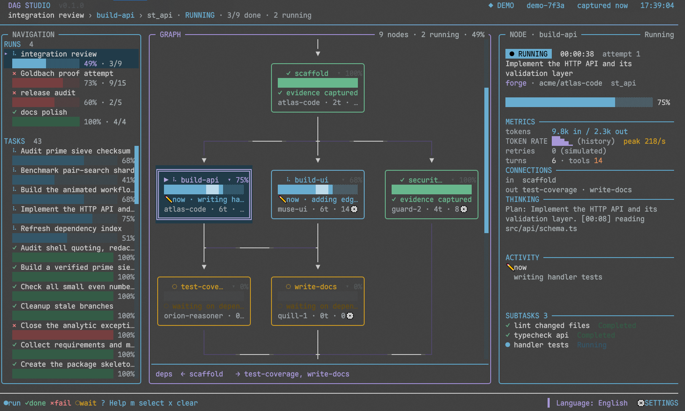

# Herdr DAG Studio

[English](README.md) | **中文**

面向 **OmO** workflow 的动画化三栏终端仪表盘，运行在 **Herdr** 侧栏中。
架构延续“扩展写快照、viewer 读快照”的方式，但重写了展示层。



*演示模式：运行中的 integration review，右侧显示选中节点的详情。*

## 特性

- **导航栏**：活动/失败/已完成 run 列表、迷你进度条、独立任务列表；
  run 标题取自创建 run 时 OmO TODO 中正在进行的条目。
- **DAG 画布**：拓扑分层、自适应换行、边流动点、运行 spinner、
  呼吸边框、进度微光、折叠节点、自动跟随滚动。
- **详情面板**：状态、耗时、agent/model、token 输入输出、轮次、工具调用、
  重试次数、实时活动、token 速率 sparkline、依赖、子任务、错误、模型思考/回复摘录；
  按 `d` 进入详细模式时显示最近日志。选中 run 时显示运行汇总：token、成本、
  缓存命中率、墙钟/忙碌时长、关键路径与并行度；节点证据不完整时标注 `seen/total`。
- **动画**：有运行中任务、活动滚动或 demo 时按 60 fps 播放（可用 `--fps N` 提升到 120）；宽屏三栏布局至少保持 24 fps，窄屏 duty 布局降到 1 fps，pager 暂停帧循环；输入/状态变化会立即重绘；`--no-motion` 保留 1 fps 时钟刷新。包含平滑 PageUp/PageDown 与鼠标滚轮滚动、LIVE 呼吸点。状态变化提示显示在 footer，不会覆盖画布或详情。
- **与 OmO 一致的主题**：system、dark、light、grok-day、grok-night 五套，使用 OmO 的配色；
  `system` 按终端明暗外观切换，页面背景与正文使用终端默认色，因此终端的背景设置
  （包括半透明效果）会直接透出。未在设置中手动选择前，默认跟随 OmO 的 `theme` 设置。
  按 `s` 打开设置切换，选择保存到 `~/.config/nero-herdr-dag/config.json`。
- **中英文界面**：按 `s` 打开“设置 / SETTINGS”弹窗，或点击 footer 最右侧的 `⚙ 设置`；可选择 English 或中文；
  选择会保存到 `~/.config/nero-herdr-dag/config.json`，下次启动自动恢复。
- **复杂演示用例**：内置 15 节点的“Goldbach 证明尝试”campaign，包含 21 个
  Goldbach 主题任务和 25 个子任务，用于展示大规模失败 workflow。
- **零运行时依赖**：仅使用 Node.js 内置模块。

## 快速开始

需要 **Bun 1.4+**。安装后的 viewer 优先使用 Bun，找不到 Bun 时回退到 Node.js 24+。

```bash
bun install
bun run demo
```

直接在当前终端启动假数据演示。单帧渲染：

```bash
bun run demo:once
bun src/viewer.mjs --demo --once --no-color --width 120 --height 40
```

生成假数据快照：

```bash
bun run make-demo
# demo/snapshot.json
```

## 演示数据

`src/demo.mjs` 在 160 秒周期内生成完整 workflow：

- `intake → scaffold → build-api / build-ui / security-review`
- `build-api → test-coverage / write-docs`
- `test-coverage + security-review + write-docs → verify-evidence → release`
- 另外三个静态 run：`Goldbach proof attempt`（失败）、`docs polish`（全部完成）、
  `release audit`（失败 + 取消）
- 独立任务：运行中、已完成、等待中、暂停中、失败
- API / 测试 / 文档 / Goldbach 任务带子任务

默认从周期第 32 秒开始，因此一启动就能看到多个并行节点。
`--scenario early` 从头开始，`--scenario late` 从周期后段开始。

### Goldbach 证明尝试

演示还包含一个合成的 **Goldbach 证明尝试** campaign，15 个节点覆盖：
命题形式化、素数筛、小范围穷举、到 4e18 的有限区间配对搜索、Lean 形式化与
kernel 检查、反例搜索、解析例外集估计、归纳步骤、独立评审、证据打包与发布。
该 campaign 包含 21 个 Goldbach 主题任务和 25 个子任务。
解析估计和归纳步骤显式失败，下游节点被阻塞，发布声明被取消。

这是一个用于展示复杂 workflow 的合成用例，**不是**对哥德巴赫猜想的真实证明
——该猜想目前仍未解决。启动 demo 后可按 `←/→` 或点击侧栏中的 run 查看；
关联任务显示在节点详情里，侧栏还有 `Audit prime sieve checksum`、
`Benchmark pair-search shard`、`Review Lean induction lemma` 等独立任务。

## 按键

| 按键 | 作用 |
| --- | --- |
| `↑/↓`、`j/k` | 当前聚焦区域向上/向下滚动一行 |
| `Tab` / `Shift-Tab` | 选择下一个/上一个 cell |
| 鼠标点击 | 选中节点、任务或 run |
| `m` | 释放鼠标跟踪，交给 Herdr 拖选/复制；再按一次恢复 viewer 鼠标操作 |
| `x` / `X` | 从当前视图隐藏已结束（完成或失败）的运行和任务 / 恢复它们 |
| 鼠标滚轮 | 向上/向下滚动一页 |
| `←/→` | 切换 run |
| `Space` / `Enter` | 折叠/展开当前节点 |
| `d` | 在宽屏或展开详情中切换详细模式；窄屏任务面板保持紧凑 |
| `t` | 聚焦任务详情；窄屏下打开切换器 |
| `1` / `2` / `3` | 窄屏下聚焦 RUNS / CELLS / 当前节点面板 |
| `e` / `Esc` | 聚焦详情 / 返回画布 |
| `f` | 开关自动跟随 |
| `s` | 打开设置（主题、动画、语言） |
| `S` | 宽屏下开关侧栏 |
| `g` / `G`、`Home` / `End` | 当前聚焦区域滚到顶部/底部 |
| `PageUp/PageDown` | 当前聚焦区域翻半页 |
| `r` | 重启动演示周期 |
| `?` / `Esc` | 打开/关闭详细帮助；footer 的 `? 帮助` 可点击。帮助可用 `↑/↓`、`PageUp/PageDown`、`g/G`、`Home/End` 滚动 |
| `q`、`Ctrl+C`、`Ctrl+D` | 退出 |

footer 保留图例（`●运行 ✓完成 ×失败 ◌等待`），后面是可点击的 `? 帮助`、`m 选区`、`x 清除` 提示，`⚙ 设置` 始终在最右侧。54-69 列时图例收缩为 `● ✓ × ◌`，两个操作名称仍然显示；窄于 54 列时只保留按键。帮助打开时由它接管键盘：后台按键被阻止，按 `?`、`Esc` 或左键关闭。
设置统一收在弹窗中：主题、动画、语言。主题和语言会保存；动画在持久化之前明确标注为“本会话”。隐藏已结束项只影响当前视图，`X` 可恢复，不会删除快照或记录文件。
在 Herdr 中按 `m` 后即可原生拖选；默认 `copy_on_select = true` 时松开鼠标即复制。

## 安装为 OmO 扩展

使用 Makefile 安装、更新或卸载：

```bash
make install
make update
make uninstall
```

`make install` 会执行 `bun install`、构建 `dist/` 并安装新的扩展 generation；
`make update` 重新安装当前 checkout（不会自动 git pull）；`make uninstall`
只删除受管理的 wrapper 和 integration 目录，保留用户配置与状态。

等价的显式命令：

```bash
bun install
bun run build
bun scripts/install.mjs --dry-run
bun scripts/install.mjs

# 或使用 CLI
bun bin/dag-studio.mjs install --agent-dir /path/to/agent
bun bin/dag-studio.mjs uninstall --agent-dir /path/to/agent
```

安装生命周期的目标（`make install`、`make update`、`make uninstall`）都支持
`AGENT_DIR=/path/to/agent` 指定非默认 agent 目录；`make test`、`make build`、
`make check` 分别运行 Bun 测试、构建和完整检查。

安装目录优先级：

1. `--agent-dir PATH`
2. `OMO_CODING_AGENT_DIR`
3. `SENPI_CODING_AGENT_DIR`
4. `~/.omo/agent`

安装器会在 `<agent-dir>/herdr-dag-studio/integration/` 下创建新的
generation，并写入稳定入口 `<agent-dir>/extensions/omo-herdr-dag-studio.js`。
每次安装使用新的模块路径，`/reload` 后能真正加载新的传递依赖；旧 generation
保留为备份。

安装后在 Herdr pane 中启动新的 OmO 会话，或在现有会话运行 `/reload`，然后：

```text
/dag-studio
```

扩展激活条件：

- `HERDR_ENV=1`
- 设置 `HERDR_PANE_ID`、`HERDR_SOCKET_PATH`
- socket 路径存在
- 能通过 `HERDR_BIN_PATH` 或 `PATH` 找到真实 `herdr`

viewer 通过 `herdr pane split --ratio 0.667 --no-focus` 并带 `--pane` 标志打开。
Herdr 的 ratio 是原 pane 的占比，所以原 pane 保留三分之二，嵌入 viewer pane
占整体宽度三分之一。窄 pane 纵向堆叠 RUNS、CELLS 和当前节点/详情面板，
活动面板带有焦点字形；该宽度不显示图谱。放大或全屏后，导航栏和图谱会自动
恢复显示。手动关闭的 pane 不会被后台事件重新打开，只有 `/dag-studio` 会强制重开。

## 配置

| 变量 | 默认值 | 用途 |
| --- | --- | --- |
| `OMO_HERDR_DAG_STUDIO_STATE_DIR` | `~/.omo/agent/herdr-dag-studio` | 快照、pane 记录、视图偏好 |
| `OMO_HERDR_DAG_STUDIO_TASK_STATE_DIR` | `~/.omo/agent/projects/<project-key>/senpi-task` | OmO agent 任务存储根目录；不再读取仓库内的 store |
| `OMO_HERDR_DAG_STUDIO_RUNTIME` | 探测到的 Bun 1.4+ / Node 24+ | viewer 运行时；兼容旧变量 `OMO_HERDR_DAG_STUDIO_NODE` |
| `OMO_HERDR_DAG_STUDIO_RETENTION_DAYS` | `14` | 过期快照清理；`0` 关闭 |
| `OMO_HERDR_DAG_STUDIO_STALE_MS` | `60000` | 快照年龄超过该毫秒数即标记 `▲ STALE`；无效或非正值使用默认值 |
| `NERO_HERDR_DAG_CONFIG_DIR` | `~/.config/nero-herdr-dag` | 覆盖界面配置目录（语言保存在 `config.json`） |

连接状态的快照超过 `OMO_HERDR_DAG_STUDIO_STALE_MS` 后，header 和来源区块会显示
`▲ STALE`，已用时间冻结在采集时刻而不再增长；窄于 48 列时 header 保留紧凑年龄
（如 `8h`）。不可读的来源存储会持续显示在 `来源` 下，并列出计数、根目录、
扫描时间和错误；重试次数会标明来源（`derived from turns`、`recorded from failed turns`
或 `not recorded`）；token 速率区分为 `(instant)`、`(average (lifetime))`、`(constant)`、
`(tick-sampled)` 和 `(history)`。

语言也可以按 `s` 修改，或点击 footer 最右侧的 `⚙ 设置`。workflow 提供的标签、任务描述和日志
保持原样，只翻译界面固定文案。

## 架构

```text
OmO 进程                                  Herdr viewer 进程
┌──────────────────────────────┐          ┌──────────────────────────────┐
│ extension.mjs                │ snapshot │ viewer.mjs                   │
│  ├─ omo.dag.updated          │ ───────> │  ├─ fs.watch + 60fps 循环    │
│  ├─ omo.task.updated         │   JSON   │  ├─ model / graph layout     │
│  ├─ 任务存储 watcher         │          │  ├─ canvas + theme + panels  │
│  ├─ DAG checkpoint 恢复      │          │  ├─ keys / follow / folds    │
│  └─ stream tap（子 agent）   │          │  └─ .view.json sidecar       │
│            │                 │          └──────────────────────────────┘
│            └─ herdr pane split/rename/run/close
└──────────────────────────────┘
```

- `src/model.mjs`：兼容 v1/v2 快照，清理控制字符，计算拓扑层。
- `src/demo.mjs`：确定性假数据世界。
- `src/graph.mjs`：frontier 换行、Manhattan 边、动画流动点。
- `src/canvas.mjs`：单元格画布，支持 truecolor/256 色。
- `src/render.mjs`：header、导航、画布、详情、footer、toast、设置菜单、帮助层。
- `src/i18n.mjs`：英文/中文文案表；`src/config.mjs`：语言配置的读取与原子保存。
- `src/controller.mjs`：事件串行队列、快照写入、Herdr pane 生命周期。
- `src/task-data.mjs`：任务存储读取与父子关系。
- `src/stream-tap.mjs`：捕获子 agent 的流式活动。

快照只保存任务字段白名单；prompt、完整输出、完整 final response、transcript
不会写入快照；详情面板只显示有界、清理后的思考/回复摘录。

## 开发与验证

```bash
bun test            # 319 项行为测试
bun run build       # 语法检查 + 组装 dist/
bun run check       # test + build
```

测试覆盖：快照规范化、拓扑分层、演示时间轴、120/90/70 列响应式渲染、
ANSI/no-color 输出、视图偏好、中英文文案一致性、语言配置持久化、设置菜单、
连线拐角与绕行障碍、共享连线通道、平滑滚动缓动、复杂 Goldbach 演示用例、
pane 复用与失败处理。

## 限制

- 依赖 OmO/Senpi 内部事件与任务存储契约，未来版本可能变化。
- viewer 优先使用 Bun 1.4+，找不到时回退到 Node.js 24+；不会用编译后的
  OmO/Bun 二进制当解释器。
- 演示数据完全合成，不执行真实 agent 或 workflow。

## 许可证

MIT。
